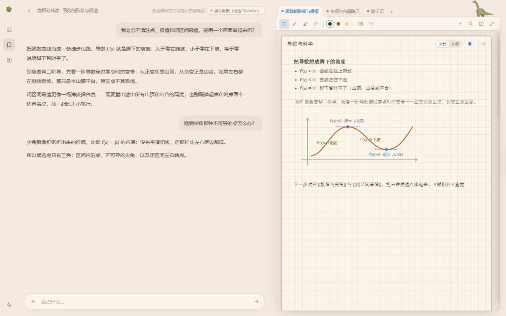
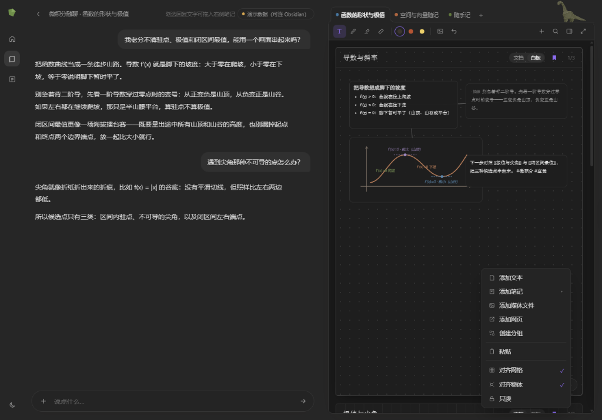
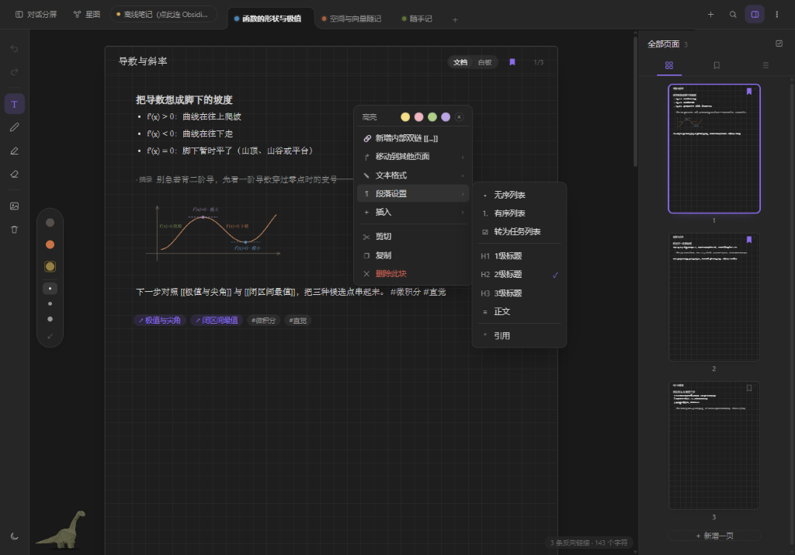

# Origami Notes · 折纸笔记

[](https://starity777-byte.github.io/origami-notes/)
[](./LICENSE)
[](#快速体验)
[](#连接本地-obsidian-库可选)

> **在对话旁长出笔记**——在极简 AI 伴读聊天里随手划选任意一句话，拖进右侧 A4 折纸笔记本，即时生长为结构化文档、自由白板、矢量涂鸦与本地 Obsidian 知识星图。

🔗 **在线试玩（免安装，纯浏览器即开即用）**：
- **伴读分屏（主界面）**：https://starity777-byte.github.io/origami-notes/
- **独立书桌 & 知识星图**：https://starity777-byte.github.io/origami-notes/desk.html

---

## 界面预览

### 1. 伴读分屏：对话直接长出笔记（日间折纸风）
左侧极简对话，右侧统一 A4 比例连续书页、连续曲率 SVG 液态页签与整齐一体化的编辑工具条。划选导师回复中的任意片段，拖过中缝即可带落地线插入笔记。



### 2. 文档 / 白板同源切换 & Obsidian Canvas 风格右键菜单
同一页笔记一键切为自由白板（自动适应分屏宽度，支持平移缩放、网格/物体对齐与只读锁定）；右键白板空白处即可添加文本、已有笔记、图片、网页或分组，悬停图片可拖拽右下角无级缩放。



### 3. 独立书桌：Obsidian 炭黑暗夜模式 + A4 结构缩略图 + 知识星图
点击右上角 `⤢` 一键展开为独立书桌（`desk.html`）：支持纯中性炭黑暗夜色系、Obsidian 多级文字右键菜单、右侧华为笔记式 A4 结构缩略图（含批量多选导出与可编辑大纲），以及基于 `[[双链]]` 与 `#标签` 的本地力导向知识星图。



---

## 核心特性

- **对话长出笔记**：在聊天流中自由划词出现拖拽把手，拖入右侧文档页（带横向落地指示线）或白板页（落点坐标），零复制粘贴阻力。
- **双视图共用数据**：文档页（A4 小方格纸、双击空白防误触加块、拖拽排序落地线、完整圆角荧光高亮）与白板页（自由摆放、缩放、连线、分组、Canvas 右键菜单）随时切换不丢内容。
- **手绘矢量涂鸦与图片缩放**：支持钢笔、荧光笔、橡皮与撤销，涂鸦独立存为 `.ink.svg`；图片块悬停右下角 L 形角标即可像 Obsidian 一样自由拖拽调宽。
- **连续曲率液态页签 & 边缘收纳**：基于弹簧插值（`Spring(380, 28)`）的无缝页签；伴读分屏支持拖笔记本左边缘自由调宽，拖窄后液态收纳为右侧边缘书签条。
- **本地优先、开箱即用**：纯静态单文件 HTML + 零第三方后端依赖，内置虚构示例数据，离线双击即可体验；可选搭配 0 依赖 Python 桥接脚本直连本地 Obsidian Vault。

---

## 快速体验

### 方式一：纯静态直接打开（无需安装任何环境）
下载或克隆仓库后，直接用浏览器双击打开：
- `index.html` — AI 伴读分屏主界面（内置虚构示例对话与 3 本示例笔记，纯离线假数据即可完整交互）
- `desk.html` — 独立全屏折纸书桌与本地知识星图

### 方式二：连接本地 Obsidian 库（可选）
项目附带零依赖 Python 3 桥接脚本 `obsidian_bridge.py`（仅用标准库，无需 `pip install`）：

```bash
python obsidian_bridge.py
```

Windows 用户也可直接双击 `start.bat`。启动后访问 `http://127.0.0.1:8788/`：
- 默认加载仓库内的虚构示例库 `demo-vault/`；
- 点击顶栏 Vault 按钮可切换为你本机任意 Obsidian 文件夹（子目录自动映射为书本，`.md` 映射为书页，涂鸦同步写为同名 `.ink.svg`，完全兼容原生 Obsidian 阅读与编辑）。

---

## 目录结构

```text
origami-notes/
├── index.html          # AI 伴读分屏主入口（对话长出笔记）
├── desk.html           # 独立全屏书桌（结构缩略图 / 多选导出 / 知识星图）
├── obsidian_bridge.py  # 可选：零依赖本地 Obsidian Vault 读写桥接服务
├── start.bat           # Windows 一键启动脚本
├── demo-vault/         # 虚构示例 Obsidian 库（微积分 / 线代 / 随手记）
├── assets/             # README 预览截图
└── LICENSE             # MIT License
```

---

## 开源协议

本项目基于 [MIT License](./LICENSE) 开源，欢迎自由使用、二次创作与接入你自己的对话模型。
